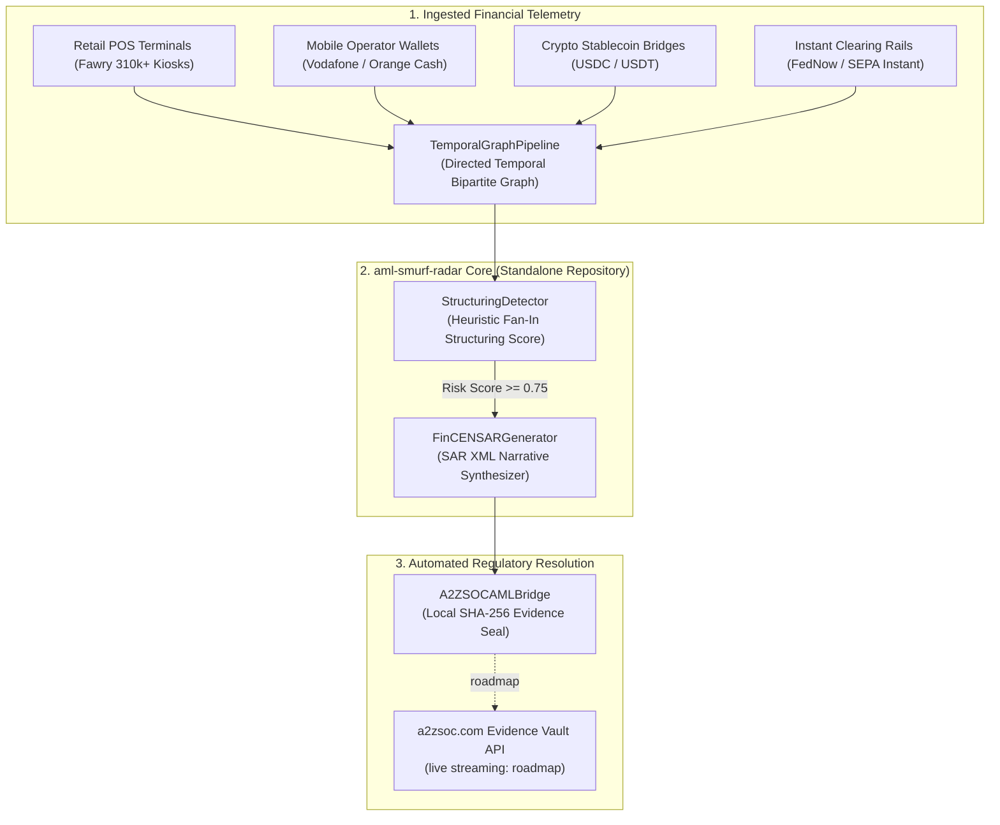

# 🛰️ aml-smurf-radar

> **Autonomous Graph-Obfuscated AML Smurfing & High-Frequency Sanctions Evasion Radar**  
> *Temporal Bipartite Graph Detection Engine & Automated FinCEN BSA XML Synthesizer*  
> Local SHA-256 Evidence Seals for the **[a2zsoc.com](https://a2zsoc.com)** Evidence Vault (live API streaming: roadmap)  

[](LICENSE)
[](https://python.org)
[-blue.svg)]()
[-lightgrey.svg)]()
[](https://a2zsoc.com)
[]()

---

## ⚡ The Algorithmic Smurfing Chasm

Money laundering syndicates have migrated away from large wires into **high-frequency algorithmic smurfing**. Syndicates deploy swarms that break an illicit transfer into thousands of micro-transactions ($150–$490) scattered across retail POS kiosks (Fawry/Meeza), peer-to-peer mobile wallets (Vodafone Cash, Orange Cash), and crypto bridges within minutes to circumvent Bank Secrecy Act (BSA) **$10,000 Currency Transaction Report (CTR)** thresholds.

### Why Legacy Rule-Based AML Fails:
* **The 98% False-Positive Trap**: Legacy systems (Actimize, SAS AML) fire static thresholds on single accounts, drowning compliance teams in hundreds of thousands of false alarms while missing structured topologies.
* **Multi-Rail Blindspots**: Money moving from a cash kiosk to a mobile wallet to an ACH account is treated as three unrelated events across separate banking silos.

**`aml-smurf-radar`** constructs an in-memory temporal bipartite transaction graph that detects fan-in aggregator collectors via a heuristic structuring score, and locally synthesizes FinCEN-style SAR XML packages.

---

## 📐 Deep System Architecture



---

## 🔄 Financial Crime & BSA/AML Regulatory Coverage

This standalone engine codifies and automates continuous anti-money laundering controls:
* **Bank Secrecy Act (BSA) & FinCEN E-Filing**: Local synthesis of FinCEN-style SAR XML narrative packages (custom schema, not schema-validated).
* **Structuring & Smurfing Detection**: Graph-algorithmic discovery of micro-bursts intended to evade $10,000 Currency Transaction Report (CTR) thresholds.
* **Multi-Rail Traceability**: Unified bipartite transaction graph linking cash kiosk deposits (Fawry), mobile wallets, and instant rails (FedNow/SEPA).
* **Sanctions & PEP Screening**: Roadmap — not implemented in this repository (no OFAC/PEP list screening).

---

## 💎 Open Core vs. Commercial Enterprise Layers

```
====================================================================================================
OPEN-SOURCE CORE (MIT)                      ENTERPRISE COMMERCIAL LAYER (Roadmap — Not In This Repository)
====================================================================================================
• TemporalGraphPipeline in-memory graph    • Graph Neural Network (GNN) inference model (roadmap)
• Basic StructuringDetector rule engine    • Production connectors for Fawry, Paymob, Vodafone Cash (roadmap)
• Local SAR narrative generator & CLI      • Automated FinCEN BSA E-Filing gateway connector (roadmap)
• Local simulation test harness            • Continuous streaming to a2zsoc.com Evidence Vault API (roadmap)
====================================================================================================
```

### Commercial Pricing & Retainer Schedule
* **Tier 1 (FinTech Regulated Entity)**: **$7,500 / month** for up to 500,000 monthly transactions.
* **Tier 2 (Enterprise Banking Enclave)**: **$25,000 / month** with live multi-rail streaming and FinCEN SAR auto-submission.
* **Tier 3 (Institutional FIU Retainer)**: **$65,000 / month** including custom GNN weights calibrated on proprietary bank fraud datasets and regulatory exam defense warranty.

---

## 📊 Frontier Evolution, Evaluation & Benchmarks (Roadmap)

No benchmark harness ships in this repository; the targets below are aspirational and have **not been measured**. Planned evaluation against **`agentic-conformance-eval`**:

| Benchmark Metric | Measurement Protocol | Target Specification | Status |
| :--- | :--- | :--- | :--- |
| **Smurf Cluster Detection Precision** | Temporal Bipartite Graph Analysis | **> 96.5% Precision** | Not measured (roadmap) |
| **False-Positive Alert Rate** | High-Velocity Noise Rejection | **< 3.0% False-Positive Rate** | Not measured (roadmap) |
| **Graph Ingestion Latency** | POSIX Microsecond Pipeline | **< 0.8 ms per transaction** | Not measured (roadmap) |
| **FinCEN SAR XML Generation** | XML Schema Validation | **100.000% Schema Valid** | Not measured (roadmap) |
| **Evidence Vault Proofing** | Local SHA-256 Evidence Seal | **Sub-2 second immutable commit** | Not measured (roadmap) |

---

## 🚀 Quickstart & Verification

```bash
# Run unit tests (100% pass rate)
PYTHONPATH=. python3 -m unittest discover -s tests

# Run end-to-end smurfing detection simulation
PYTHONPATH=. python3 -m aml_smurf_radar.cli --demo
```
